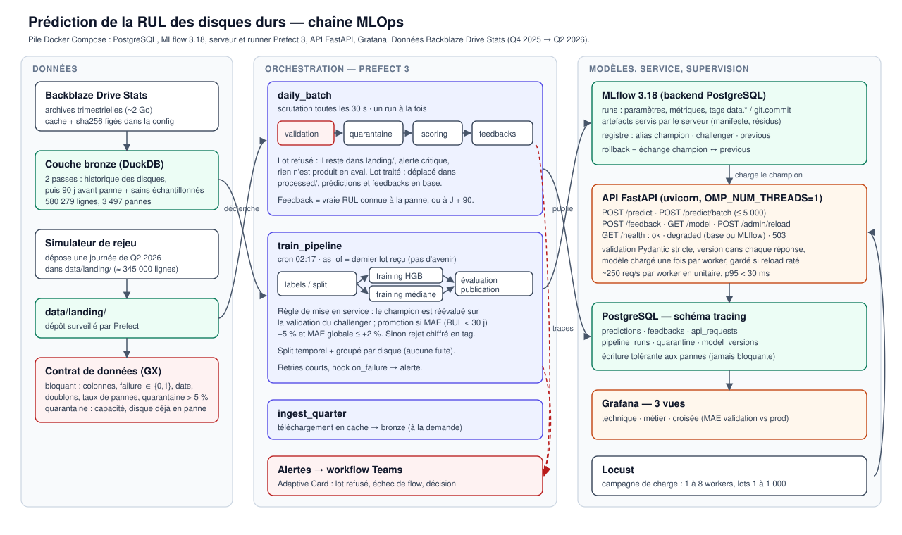

# Prédiction de la durée de vie restante des disques durs — chaîne MLOps

Projet final 5MLDE. On prédit la **RUL** (*Remaining Useful Life*) d'un disque
dur — le nombre de jours avant sa panne — à partir de ses statistiques SMART du
jour, sur les données publiques **Backblaze Drive Stats**.

> L'objet du projet n'est pas la performance prédictive : c'est une chaîne
> d'exploitation reproductible, tracée et démontrée de bout en bout — ingestion,
> contrôles qualité bloquants, orchestration, registre de modèles, API,
> feedbacks, supervision, tests de charge.

---

## 1. Le problème

| | |
|---|---|
| **Tâche** | Régression. `rul = date_panne - date`, en jours. |
| **Cible** | Plafonnée à **H = 90 jours** (configurable). La valeur `90` signifie « pas de panne en vue dans l'horizon ». |
| **Features (v1)** | L'**état du jour** uniquement : 10 attributs SMART *raw* (5, 9, 12, 187, 188, 193, 194, 197, 198, 199), le modèle de disque (top-K + modalité « autre »), la capacité en To, le constructeur. Une seule ligne Drive Stats suffit, donc l'API répond sans historique du disque. |
| **Population** | Toutes les lignes des disques tombes en panne sur leurs 90 derniers jours, plus un échantillon déterministe de disques sains étiquetés `H`. |
| **Modèles** | Baseline `DummyRegressor(median)` et `HistGradientBoostingRegressor`, entraînés **en parallèle**. |
| **Métriques** | MAE globale, **MAE sur RUL < 30 j** (la zone qui compte en exploitation), précision et rappel de l'alerte « RUL prédite < 30 j ». |

### Le label, et pourquoi il arrive en retard

C'est le cœur du prétraitement, et la principale subtilité du sujet.

- **Disque en panne** : `failure = 1` signifie que le disque est tombe en panne
  **ce jour-là** — c'est sa dernière ligne dans les données. Chaque ligne de la
  fenêtre `[date_panne - H, date_panne]` reçoit `min(date_panne - date, H)`.
- **Disque sain** : sa vraie RUL est inconnue (censure à droite). Une ligne datée
  `d` n'est étiquetée **que si le disque est encore observé vivant à `d + H`**.
  Alors RUL >= H, donc le label plafonne `H` est *exact* : pas de biais de
  censure. Les lignes trop récentes sont écartées, et comptées.

Conséquence : le label d'une ligne du jour n'est connu que lorsque le disque
tombe en panne, ou H jours plus tard. Chaque réentraînement travaille donc sur
une **fenêtre glissante de lignes dont le label est résolu**, et les périodes
d'entraînement changent d'un run à l'autre (paramètre `--as-of`).

---

## 2. Architecture



Vue simplifiée :

```
 Backblaze (zip)  ──►  ingestion (cache + sha256)  ──►  data/raw/ (CSV, gitignore)
         │                                                      │
 generateur synthetique ───────────────────────────────────────► │  (execution hors ligne)
                                                                 │
        simulateur de rejeu ──► data/landing/<jour>.csv          │
                                      │ declenche               │
 ┌──────────────────────────── Prefect 3 ──────────────────────▼──────────────────────────┐
 │ daily_batch    : validation (GX) ─✗─► alerte + ARRET du lot                            │
 │                  └─✓─► quarantaine ─► scoring ─► feedbacks automatiques                │
 │ train_pipeline : ingestion ► validation ► labels/features                              │
 │                  ► [ baseline  ∥  HistGradientBoosting ] ► evaluation ► publication    │
 │ ingest_quarter : telechargement cache ► couche bronze DuckDB (2 passes)                │
 └──────────────┬──────────────────────────────────────────────────────┬──────────────────┘
                ▼                                                      ▼
   MLflow (runs, artefacts, registre, alias champion)        alertes webhook (Teams/Slack)
                │  charge une fois par worker
                ▼
   API FastAPI :8001  ──►  PostgreSQL (schema tracing)  ──►  Grafana (3 vues)
                ▲
             Locust
```

### Structure du dépôt

```
.
├── config/                 base.yaml (reference) + demo.yaml (overlay reduit)
├── src/hdd_rul/
│   ├── common/             configuration Pydantic, logs, hachage, alertes, traces
│   ├── ingestion/          telechargement cache, generateur synthetique, bronze DuckDB, landing
│   ├── validation/         contrat Great Expectations + 3 expectations personnalisees
│   ├── features/           labels RUL, features v1, pretraitement sklearn
│   ├── training/           modeles, split, metriques, registre, regle de promotion
│   ├── serving/            chargement du champion, scoring, feedbacks
│   ├── orchestration/      flows et deployments Prefect
│   └── cli.py              point d'entree unique en ligne de commande
├── api/                    FastAPI (schemas Pydantic + application)
├── sql/init-db.sql         schema `tracing` et vues de supervision
├── grafana/                provisioning + dashboard (genere par script)
├── loadtest/               scenarios Locust, protocole, resultats
├── scripts/                rejeu, injection d'incidents, demonstrations
├── tests/                  114 tests (unitaires, contrat, API, flows, bout en bout)
├── compose.yml, Dockerfile, mise.toml, pyproject.toml, uv.lock
└── README.md, DATA.md, TRACABILITE.md, SYNTHESE_OPS.md
```

---

## 3. Installation

Pre-requis : **Docker Compose** (le projet s'exécute sur la pile Compose),
**Python 3.12** et [uv](https://docs.astral.sh/uv/) pour les commandes et les
tests. [mise](https://mise.jdx.dev/) est pratique mais optionnel : chaque tâche
a son équivalent `uv run`.

```bash
git clone https://github.com/matteochretien/5mlde-projet.git && cd 5mlde-projet
cp .env.example .env            # ajuster si besoin (mots de passe, webhook)

mise install && mise run setup  # ou : uv sync --all-extras
mise run lint                   # ou : uv run ruff check . && uv run ruff format --check .
mise run test                   # ou : uv run pytest -m 'not integration'
```

`uv.lock` fige toutes les versions : l'installation est reproductible à
l'identique.

> **Deux versions épinglées volontairement.** `fastapi < 0.155` : la 0.155
> supprime le paramètre déprécié `min_items`, encore utilisé par le serveur
> Prefect 3.8, et plus aucun serveur Prefect ne démarre au-delà. Le conteneur
> Prefect réinstalle `sqlalchemy < 2.1` avant de démarrer, pour la même raison
> côté planificateur (détails dans `compose.yml` et `SYNTHESE_OPS.md`).

---

## 4. Données

Provenance, licence, schéma, pièges et empreintes : **[`DATA.md`](DATA.md)**.

### Données réelles

```bash
mise run download    # ou : uv run python -m hdd_rul.cli download
mise run ingest      # ou : uv run python -m hdd_rul.cli ingest
```

Les archives (~2 Go par trimestre) sont mises en cache et vérifiées par `sha256`.
`data/`, `*.zip` et `mlruns/` sont exclus du dépôt : **aucune donnée Backblaze
n'est redistribuée**.

### Données synthétiques (exécution hors ligne, tests, démonstration)

```bash
mise run data:synthetic   # ou : uv run python -m hdd_rul.cli --config config/demo.yaml synthetic
```

Le générateur produit des fichiers journaliers **au même format** que Backblaze.
Le pipeline ne fait aucune différence entre les deux sources. Les métriques
obtenues sur le jeu synthétique ne mesurent pas la qualité prédictive — voir la
section « honnêteté » de `DATA.md`.

### Simulation du temps sur un jeu historique figé

Conformément à ce que permet le sujet, le trimestre Q2 2026 est **rejoué jour par
jour** : le simulateur dépose `2026-04-07.csv` dans `data/landing/`, ce qui
déclenche le flow `daily_batch`. Les prédictions, les feedbacks et les traces
arrivent donc comme dans un vrai flux. Le paramètre `--as-of` fait en plus
varier la fenêtre d'entraînement d'un réentraînement à l'autre.

---

## 5. Commandes

| Tâche `mise` | Équivalent direct | Effet |
|---|---|---|
| `mise run setup` | `uv sync --all-extras` | Environnement et dépendances verrouillées. |
| `mise run lint` | `uv run ruff check . && uv run ruff format --check .` | Lint et format. |
| `mise run test` | `uv run pytest -m 'not integration'` | Suite de tests. |
| `mise run data:synthetic` | `uv run python -m hdd_rul.cli synthetic` | Jeu synthétique. |
| `mise run download` | `… cli download` | Téléchargement des trimestres. |
| `mise run ingest` | `… cli ingest` | Couche bronze DuckDB (2 passes). |
| `mise run validate` | `… cli validate` | Contrat de qualité sur les lots en attente. |
| `mise run train` | `… cli train` | Entraînement, évaluation, publication, promotion. |
| `mise run replay` | `… cli replay --deposit-only` | Dépose les journées suivantes de Q2 dans `data/landing/` (le runner les traite). |
| `mise run rollback` | `… cli rollback` | Retour arrière `champion <- previous`. |
| `mise run loadtest` | `uv run locust -f loadtest/locustfile.py …` | Campagne de charge. |
| `mise run up` / `down` | `docker compose up -d --build` | Pile complète : API, runner Prefect, MLflow, PostgreSQL, Grafana. |
| `mise run demo:nominal` | `bash scripts/demo_nominal.sh` | Démonstration du cycle nominal. |
| `mise run demo:incident` | `bash scripts/demo_incident.sh` | Démonstration des incidents. |

Toute commande accepte `--config config/demo.yaml` pour travailler sur le jeu
réduit.

---

## 6. Pile complète

```bash
docker compose up -d --build
```

| Service | URL | Rôle |
|---|---|---|
| API de prédiction | <http://localhost:8001/docs> | Prédiction en ligne et par lot, feedbacks. |
| MLflow | <http://localhost:5050> | Runs, artefacts, registre de modèles. |
| Prefect | <http://localhost:4200> | Flows, deployments, logs, retries. |
| Grafana | <http://localhost:3000> | Supervision (3 vues). `admin` / `admin` par défaut. |
| PostgreSQL | `localhost:5432` | Traces, backends MLflow et Prefect. |

Un seul serveur PostgreSQL héberge trois bases : `hdd_rul` (traces, lue par
Grafana), `mlflow` et `prefect`.

---

## 7. API de prédiction

```bash
curl -s localhost:8001/health | python -m json.tool
curl -s localhost:8001/model  | python -m json.tool

curl -s -X POST localhost:8001/predict -H 'Content-Type: application/json' -d '{
  "observation": {
    "serial_number": "ZA12345678", "model": "ST4000DM000",
    "capacity_bytes": 4000787030016, "date": "2026-05-20",
    "smart_5_raw": 120, "smart_9_raw": 41714, "smart_12_raw": 48,
    "smart_187_raw": 80, "smart_188_raw": 5, "smart_193_raw": 66742,
    "smart_194_raw": 34, "smart_197_raw": 40, "smart_198_raw": 12,
    "smart_199_raw": 2
  }
}' | python -m json.tool
```

| Endpoint | Rôle |
|---|---|
| `POST /predict` | Un disque. |
| `POST /predict/batch` | Jusqu'à 5 000 disques (une journée de parc). |
| `POST /feedback` | RUL réellement constatée (panne, ou survie à J+H). |
| `GET /health` | État du service et de ses dépendances (base de traces, registre MLflow). `503` sans modèle ; `200 degraded` si la base ou MLflow est injoignable, le modèle en mémoire restant servi. |
| `GET /model` | Version servie, métriques, features attendues. |
| `POST /admin/reload` | Recharge le champion après une promotion ou un rollback, sans redémarrer. |

Points d'exploitation :

- **chaque réponse porte la version du modèle** (nom, version, alias, `run_id`) ;
- validation Pydantic stricte sur ce qui a un sens physique (compteurs SMART
  positifs, température plausible, date non future) → `422` explicite ;
- un **modèle de disque inconnu n'est pas une erreur** : il tombe dans la
  modalité « autre » du prétraitement, avec un avertissement dans la réponse.
  Refuser serait pire : le parc évolue en permanence ;
- le modèle est chargé **une fois par worker** ;
- toute requête est tracée (endpoint, latence, code, version) dans PostgreSQL.
  **Si la base tombe, l'API continue de répondre** : une trace perdue ne doit pas
  faire perdre une prédiction. `/health` le signale.

---

## 8. Qualité des données : ce qui bloque, ce qui alerte

Contrat Great Expectations appliqué **avant** tout prétraitement, avec deux
niveaux de sévérité.

**Bloquant** — le lot est refusé, le flow s'arrête, une alerte part, aucun modèle
n'est publié, et l'API continue de servir le champion en place :

- colonne obligatoire absente (identité ou attribut SMART retenu) ;
- `failure` hors `{0, 1}` ;
- `serial_number` nul, dupliqué dans la journée, ou non plausible ;
- date du fichier incohérente avec la colonne `date` ;
- **taux de pannes du lot anormalement élevé** (expectation personnalisée) : au-delà
  de 1 %, c'est un fichier abîmé ou des colonnes décalées, pas une vague de pannes ;
- part de lignes en quarantaine supérieure à 5 % du lot.

**Non bloquant** — les lignes partent en quarantaine, le lot continue, et le
compteur remonte dans Grafana :

- `capacity_bytes <= 0` (Backblaze publie parfois `-1`) ;
- **un disque déjà en panne qui réapparaît** (expectation personnalisée). La
  liste des disques en panne est calculée à chaque lot, à partir de l'historique
  ingéré et des lots déjà traités. Ce n'est pas bloquant, car les données réelles
  en contiennent : `2BJD2XYD`, déclaré en panne le 14 octobre 2025, émet encore
  chaque jour de Q2. Bloquer refuserait tout le trimestre. Une résurrection
  massive (lot déjà traité rejoué) dépasse le plafond de quarantaine et bloque ;
- température hors `[0, 80]` °C, `smart_9_raw` négatif (capteurs bruités).

Trois expectations sont **personnalisées** (`src/hdd_rul/validation/custom.py`),
parce qu'elles encodent une connaissance du jeu que la bibliothèque standard n'a
pas : plausibilité d'un numéro de série constructeur, non-résurrection d'un
disque en panne, anomalie de volume sur le taux de pannes.

Chaque rapport est archive dans `artifacts/validation/` et joint au run MLflow.

---

## 9. Orchestration

| Flow | Déclencheur | Enchaînement |
|---|---|---|
| `ingest_quarter` | Manuel | `steam-http-get` (téléchargement cache) → `ingestion` → `feature-table`. |
| `daily_batch` | **Arrivée d'un fichier dans `data/landing/`** (scrutation toutes les 30 s) | `validation` (bloquante) → `preprocessing` (quarantaine) → `score-batch` → `feedbacks`. |
| `train_pipeline` | Planifié (cron), ou manuel / rejeu | `ingestion` → `validation` → labels/features → **`training` ∥ `training`** → `evaluation-publication`. |

- **Parallélisation** : les deux candidats s'entraînent dans des tâches
  concurrentes (`.submit()`).
- **Retries** avec attente croissante (2 s, 4 s, 8 s, 16 s) sur les tâches qui
  dépendent de MLflow ou de PostgreSQL.
- **Hooks `on_failure`** : toute exécution échouée envoie une alerte et écrit son
  statut dans `tracing.pipeline_runs`.
- **Cache** : le téléchargement est cache sur ses entrées et sur le code de la
  tâche (`INPUTS + TASK_SOURCE`) ; une archive déjà présente et conforme n'est
  jamais retéléchargée.
- **Pas de sous-flow** : un lot repris doit apparaître dans **un seul** flow run,
  avec tout son historique, plutôt que dans deux runs sans lien dans l'interface.
- Un lot refusé **reste dans `data/landing/`** : on le corrige et on le rejoue.

Le service `prefect-runner` de la pile Compose enregistre et sert les trois
deployments.

```bash
mise run replay -- --limit 5   # dépose 5 journées ; le runner Prefect les traite
```

---

## 10. Traçabilité et mise en service

Stratégie complète : **[`TRACABILITE.md`](TRACABILITE.md)**.

En résumé : les tags `data.*` répondent à « sur quelles données ? », `git.commit`
à « avec quel code ? », `trigger` et `prefect.flow_run_id` à « lancé par quoi ? »,
et `promotion.decision` / `promotion.reason` à « pourquoi est-ce (ou non) en
production ? ».

**Règle de promotion** : le challenger est promu si les contrôles sont verts, si
sa MAE sur RUL < 30 j s'améliore d'au moins 5 %, et si sa MAE globale ne se
dégrade pas de plus de 2 %. Sinon il est rejeté, avec la raison chiffrée en tag.

**Retour arrière** : `mise run rollback` échange `champion` et `previous`, puis
`POST /admin/reload` fait recharger l'API sans redémarrage. Pour le démontrer, il
faut une promotion : l'overlay `config/promotion_permissive.yaml` tolère une
régression (tracée `regression_toleree:…`, jamais présentée comme une
amélioration) sans toucher au code.

---

## 11. Supervision

Grafana est provisionné automatiquement (source de données + dashboard). Le
dashboard est **généré** par `scripts/build_dashboard.py` : le JSON reste un
artefact reproductible et relisible.

- **Vue technique** — trafic par endpoint, latence p95, erreurs par code HTTP,
  exécutions de flows, version servie, lignes en quarantaine.
- **Vue métier** — disques à risque (< 30 j) par modèle de disque, distribution
  des RUL prédites, pannes constatées par jour, volumes servis.
- **Vue croisée** — MAE **réelle en production** par version de modèle, MAE sur
  la zone critique, comparatif « MAE de validation vs MAE de production », erreur
  par modèle de disque.

La vue croisée est celle qui sert à décider : c'est là qu'une dérive se voit, et
donc qu'un retour arrière se justifie.

---

## 12. Charge et dimensionnement

Protocole, mesures et recommandation chiffrée : **[`loadtest/PROTOCOLE.md`](loadtest/PROTOCOLE.md)**
(résumé dans `preuves/15_loadtest.md`).

**Recommandation : 2 workers uvicorn avec `OMP_NUM_THREADS=1`, 2 vCPU, 1 Go** ;
scoring quotidien du parc dans le runner (~30 s pour 345 000 disques).
`OMP_NUM_THREADS=1` est le réglage décisif : sans lui, chaque prédiction
HistGradientBoosting occupe tous les cœurs et l'API plafonne à ~30 req/s quel
que soit le nombre de workers ; avec, 463 req/s à 2 workers (p95 5 ms).

```bash
mise run loadtest:campaign   # campagne complète (API de test sur le port 8011)
mise run loadtest:report     # tableau de synthèse
uv run python scripts/bench_compute.py   # coût de calcul hors HTTP
# un palier isolé contre l'API de la pile Compose :
uv run locust -f loadtest/locustfile.py --headless -u 30 -r 10 -t 1m \
  --host http://localhost:8001 --class-picker PredictionLot100
```

---

## 13. Démonstration

```bash
mise run demo:nominal    # données → bronze → champion → rejeu → réentraînement → rollback
mise run demo:incident   # lot invalide bloqué, quarantaine, dépendance indisponible
```

1. **Nominal** — ingestion, entraînement, publication du champion, rejeu de
   quelques jours (scoring et feedbacks automatiques), réentraînement sur une
   fenêtre plus récente, puis promotion **ou rejet motivé**.
2. **Incident 1, lot invalide** — journée corrompue (colonne manquante,
   `failure = 2`, date incohérente, serial dupliqué) : le contrat bloque, une
   alerte part, aucun modèle n'est publié, l'API continue de servir le champion.
3. **Incident 2, dépendance indisponible** — `docker compose stop mlflow` :
   `/health` passe en `degraded`, l'API continue de prédire avec le modèle en
   mémoire, et `/admin/reload` répond vite `503` sans retirer ce modèle. Un
   entraînement lancé pendant la panne retente, puis reprend si MLflow revient,
   ou échoue proprement avec une alerte.
4. **Retour arrière** — visible dans `/model` et dans Grafana.

Ces deux scripts tournent sur le jeu synthétique (`data/demo/`), pile Compose démarrée.
Les preuves (logs, captures, identifiants de runs) sont dans **[`preuves/`](preuves/README.md)**.

---

## 14. Limites connues

- **Censure** : les disques sains ne sont étiquetés que lorsque l'horizon de 90
  jours est effectivement observé. Les dernières journées d'un trimestre ne sont
  donc pas utilisables pour l'entraînement.
- **Sémantique des attributs SMART** : elle diffère selon les constructeurs, et
  les valeurs `normalized` sont propres à chaque fabricant. D'où l'usage exclusif
  des valeurs `raw` et l'ajout d'une feature `vendor`.
- **Peu de pannes par modèle de disque** : d'où le regroupement top-K et la
  modalité « autre ». Les modèles rares restent mal servis.
- **Features v1 limitées à l'état du jour** : les tendances SMART (deltas sur 7
  jours des attributs 5, 197, 198) seraient plus informatives, mais imposeraient
  l'historique du disque — donc une prédiction par lot seulement. C'est
  l'évolution v2 identifiée.
- **Le rejeu n'est qu'une approximation d'un flux de production** : pas de
  retards, pas de données en double, pas d'arrivée partielle.
- **Jeu synthétique** : il valide la chaîne, pas la performance prédictive.

---

Source des données : **Backblaze Drive Stats**
(<https://www.backblaze.com/cloud-storage/resources/hard-drive-test-data>).
Conditions d'utilisation et périmètre dans [`DATA.md`](DATA.md).
